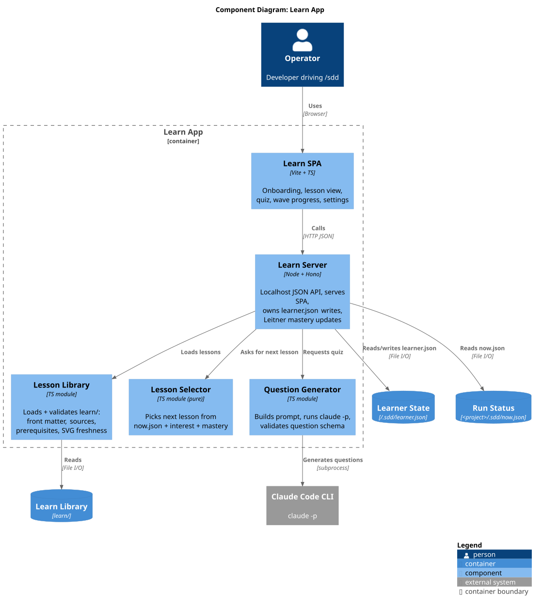

Learn App — Components
======================

The Learn App runs on the operator's machine, next to the project source.
The plugin ships it as ``learn-app/`` with its built SPA committed. It reads
the project's ``learn/`` library and ``.sdd/now.json``, and the operator's
``~/.sdd/learner.json``, which is shared by all projects. It is unrelated to the
Sphinx docs site (ADR-001).

Components
----------

Learn Server (``learn_server``)
~~~~~~~~~~~~~~~~~~~~~~~~~~~~~~~

**Responsibility**: The single Node process. Serves the built SPA and the
JSON API on ``127.0.0.1:${SDD_LEARN_PORT:-4747}``. The only writer of
``learner.json``.

**Patterns**: Thin HTTP layer (Hono) over pure modules. All file paths are
resolved under the ``--project`` root, and any path outside it is rejected.
Today's date comes from the request handler and is passed down. Mastery uses
a fixed Leitner table (boxes 0–5, intervals 0/1/2/4/8/16 days).

**Owns**: ``~/.sdd/learner.json`` schema (versioned, ``schema: 1``) and
its writes: re-read, merge, write temp file, rename. Several learn servers
(one per project) may share the file.

**Does NOT**: Write ``now.json`` (the Conductor does), generate lessons
(the Plan Skill does), or listen on any interface but loopback.

Learn SPA (``learn_spa``)
~~~~~~~~~~~~~~~~~~~~~~~~~

**Responsibility**: Operator UI. Interest onboarding on first use, a lesson
view (Markdown, SVG diagrams with zoom and pan, sources section), a quiz view
(options, then a per-option explanation and source after answering), a wave
progress strip that polls ``/api/now`` every 2 s, and a settings view for
interest.

**Does NOT**: Touch the filesystem or call Claude. Everything goes through
the server API.

Lesson Library (``lesson_library``)
~~~~~~~~~~~~~~~~~~~~~~~~~~~~~~~~~~~

**Responsibility**: Load ``learn/<domain>/<topic>/<NN>-<slug>.md`` and the
``index.yaml`` files into a typed tree, and validate it: required front
matter, at least one source per lesson, ``requires`` pointing to existing
lessons, no prerequisite cycles, referenced SVGs present and newer than
their source. Also exposed as the ``learn validate`` CLI used by the Plan
Skill and CI.

**Does NOT**: Pick lessons or render Markdown to HTML (the SPA does).

Lesson Selector (``lesson_selector``)
~~~~~~~~~~~~~~~~~~~~~~~~~~~~~~~~~~~~~

**Responsibility**: Pure function ``(library, learner, now, today) →
{lesson | null, what_changed[]}``. It filters by interest depth
(``skip`` → none, ``basics`` → intro only, ``deep`` → all levels) and by
mastered prerequisites (box ≥ 3). It ranks by active topic, then due for
review, then lowest box, then lesson order, then id. For active topics set
to ``skip`` it returns a one-line ``what_changed`` note built from the
``now.json`` job titles.

**Does NOT**: Read files or the clock.

Question Generator (``question_generator``)
~~~~~~~~~~~~~~~~~~~~~~~~~~~~~~~~~~~~~~~~~~~

**Responsibility**: Build the quiz prompt (lesson body and sources,
operator box and interest level, summaries of past misses on this lesson),
run ``claude -p --output-format json``, extract and validate the question
array: 3 questions, 3–5 options, one correct index, an explanation per
option, and a ``source`` that matches one of the lesson's sources.

**Patterns**: Subprocess adapter with a timeout. Any failure (missing
binary, timeout, schema violation, unknown source) is returned as a named
error. It never falls back to stored or placeholder questions.

**Does NOT**: Cache questions across sessions (ADR-003).
