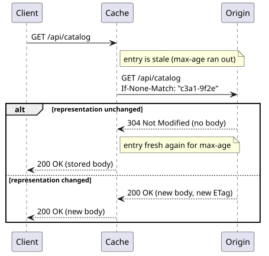

A cached response does not stay fresh for ever. Once its `max-age` runs out it becomes *stale*, but stale does not mean useless. Instead of downloading the whole body again, the cache can ask the origin one cheap question: *has this changed since I got it?*

## The validator

To ask that question the cache needs a validator from the first response. The strong choice is an `ETag`, an opaque string the server derives from the representation, often a hash of the body. The weaker fallback is `Last-Modified`, a timestamp with one-second resolution.

```
HTTP/1.1 200 OK
Cache-Control: max-age=60
ETag: "c3a1-9f2e"
```

## The conditional request

When the entry is stale, the cache sends the same request with `If-None-Match` carrying the stored ETag. If the representation is unchanged, the origin answers `304 Not Modified` with no body, and the cache marks its copy fresh again. If it has changed, the origin sends a normal `200` with the new body and a new ETag.



The body crosses the network once. Later checks cost one round trip and a few hundred bytes of headers.

## Strong and weak

A strong ETag promises byte-for-byte identity. A weak one, written `W/"c3a1"`, only promises that the content is equivalent, so a server can keep it across compression or whitespace changes. Weak validators are fine for `If-None-Match` but cannot be used for range requests.

## Where this bites in practice

Behind a load balancer, every instance must produce the same ETag for the same body. A validator built from inode numbers or instance-local timestamps turns every revalidation into a full `200`, and nobody notices until the bandwidth bill arrives.
