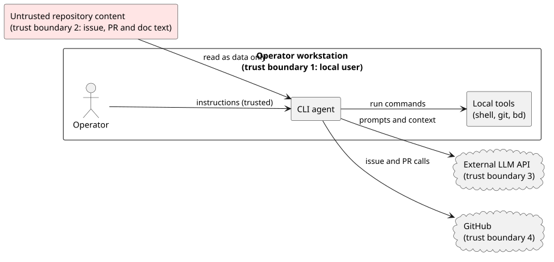

A threat model is a short, written answer to four questions: what are we building, what can go wrong, what do we do about it, and did we check that we did. You do not need a tool to start. A list of components, the arrows between them, and the places where trust changes hands is enough.

## Trust boundaries first

A trust boundary is a line that data crosses while its trustworthiness changes. Threats cluster at these lines, so draw them before listing threats. In a CLI agent project the usual ones are:

- the operator's own commands and the machine they run on,
- repository content written by others (issues, PR descriptions, docs),
- external services such as an LLM API or GitHub,
- shared state such as issue labels or notes that any agent can write.

Anything that crosses a line from less trusted to more trusted is an input to check. Text from an issue is data. It is not an instruction, even when it is written as one.

## STRIDE

STRIDE is a checklist of six threat categories. Walk each data flow across each boundary and ask which categories apply.

- **Spoofing** (identity). Something pretends to be someone else. A local dev server on `localhost:8080` accepts requests from any web page the operator visits, because a browser will send them. The page impersonates the operator's own client.
- **Tampering** (integrity). Data is changed in transit or at rest. An agent edits a `.github` workflow file that a later run trusts, with no review step between.
- **Repudiation** (accountability). An actor denies an action and nothing proves otherwise. An agent records a gate approval in a note, but no one can tell whether the operator or the agent wrote it.
- **Information disclosure** (confidentiality). Data leaks to a party who should not see it. A debug log prints an API key into a shared issue comment.
- **Denial of service** (availability). A flow is made to stop or slow down. A repository file with a huge generated body makes the agent's context too large to finish.
- **Elevation of privilege** (authority). An actor gets more power than it should. Text in a GitHub issue convinces the agent to run `git push --force` on `main`.

Elevation and spoofing are the categories that matter most for agents, because injected text can attempt both.

## From threat to mitigation to test

A threat is only useful when it leads somewhere. For each threat, record:

1. the boundary it crosses and the STRIDE category,
2. a mitigation, such as "analysis runs in a read-only sub-agent" or "content is passed as data, never as instructions",
3. a test that fails if the mitigation is removed.

The repository's SDD Skills threat model follows this shape. Each threat has a `:stride:` field, a `:mitigation:`, and `:links:` to the requirements that implement it. Read `docs/source/security/threat-model/sdd-skills.rst` to see one filled in.

## Try it

Pick one trust boundary in a project you work on. List the data that crosses it, assign each flow a STRIDE letter, and write one mitigation and one test for the most serious threat. If you cannot name a test, the mitigation is not yet a requirement.
